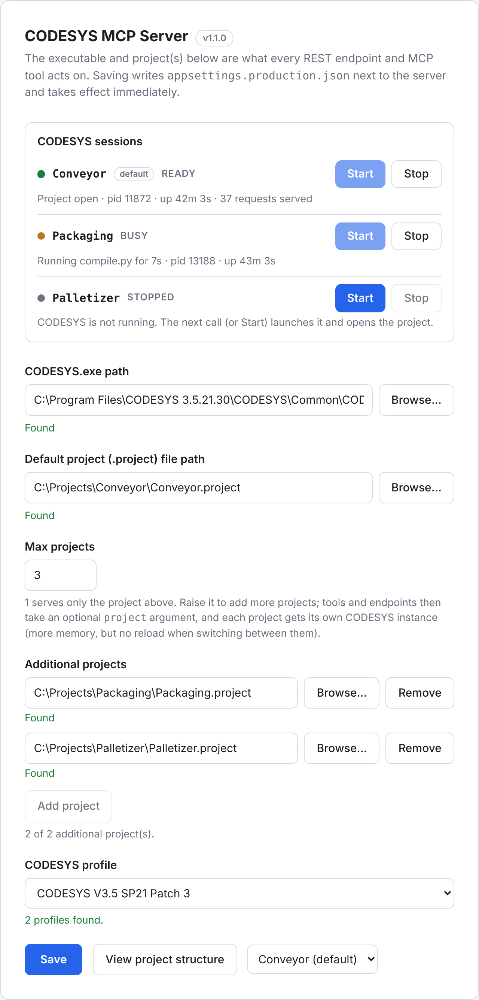
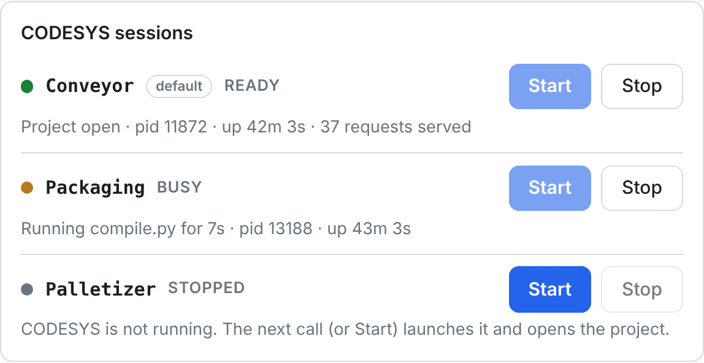

By default the server works on **one** project: the one in the **Project** field of the
[settings page](/CodesysMcpNet/guides/settings-page/). That's the safest setup and needs
nothing else. If you work with several projects at once, raise **Max projects**.

## Enabling it

1. On the settings page, set **Max projects** to how many projects you want available
   (1–10). The project field becomes the **default project**.
2. Under **Additional projects**, click **Add project** and pick each further `.project` file.
3. Click **Save**. Like every setting, it takes effect immediately.



Or, in `appsettings.production.json`:

```json
"Codesys": {
  "ProjectPath": "C:\\Plc\\Line1.project",
  "MaxProjects": 3,
  "AdditionalProjectPaths": [
    "C:\\Plc\\Line2.project",
    "C:\\Plc\\Packaging.project"
  ]
}
```

With `MaxProjects` at 1, `AdditionalProjectPaths` is ignored.

## Choosing a project per call

Every MCP tool and REST endpoint takes an optional `project` argument:

- omitted → the default project;
- a **name** — the file name without `.project` (`Line2`), case-insensitive;
- or the **full path** — needed only when two configured projects share a file name.

Only configured projects can be selected: a caller can never point the server at any other
file. The `projects` MCP tool (and `GET /projects`) lists them, with the default one marked and
the state of each project's CODESYS session, so an assistant can discover what's available.

```powershell
Invoke-RestMethod "http://127.0.0.1:5088/structure?project=Line2"
Invoke-RestMethod "http://127.0.0.1:5088/compile?project=Packaging" -Method Post -ContentType application/json -Body '{}'
```

## One CODESYS per project

With the [persistent session](/CodesysMcpNet/guides/persistent-session/) on, each configured
project gets **its own CODESYS instance** with that project kept open:

- switching between projects never pays the 30–60 s project reload;
- calls for different projects run in parallel; calls for the same project still run one at a
  time;
- every instance costs memory (often several hundred MB), which is why the default is 1;
- with `StartSessionOnStartup`, all configured projects are opened when the server starts;
- removing a project from the list (or lowering **Max projects**) stops its CODESYS and
  releases the project file.

The session card on the settings page lists every configured project with its own state, so you
can see at a glance which ones have CODESYS running. Each row has its own **Start** and
**Stop**, so you can start several sessions at the same time. A project picker next to
**View project structure** chooses whose structure is shown.



Over REST, pass `project` to `/session`, `/session/start` and `/session/stop`, or read
`GET /sessions` for all of them.

With `KeepSessionAlive` off, every call still starts its own CODESYS, one at a time, whatever
project it targets.
